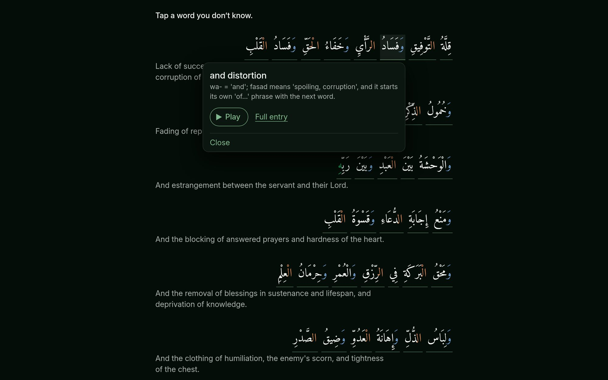
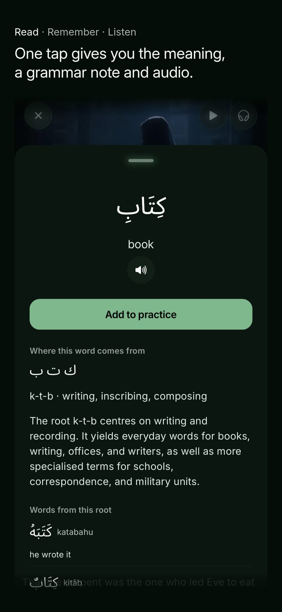
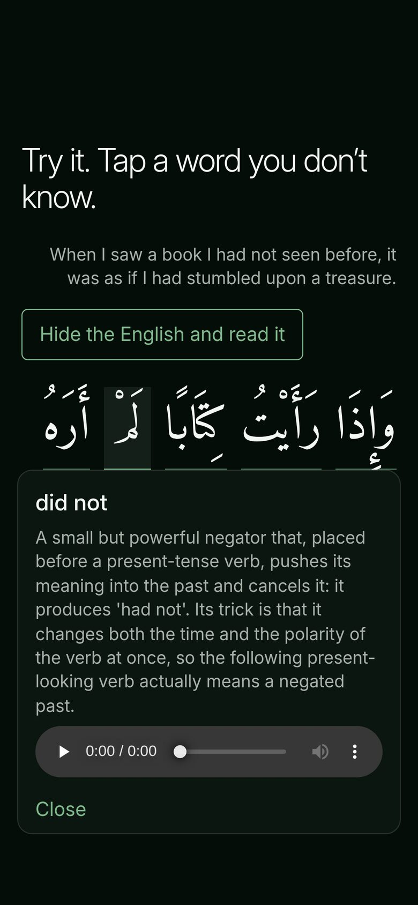
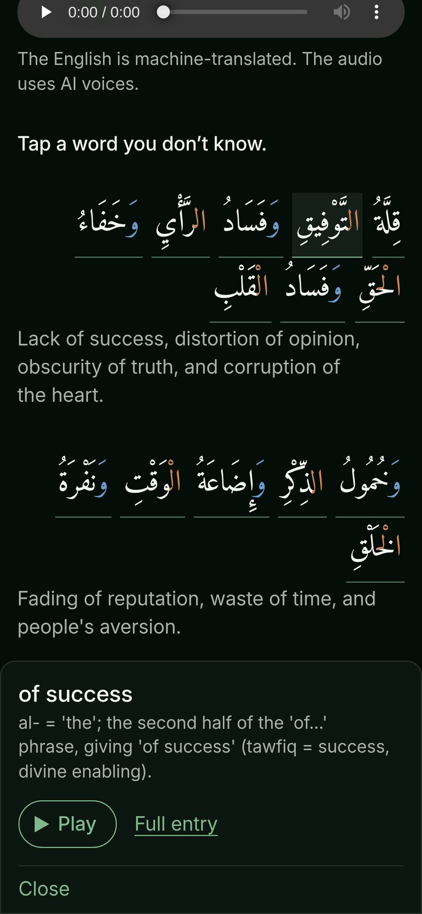
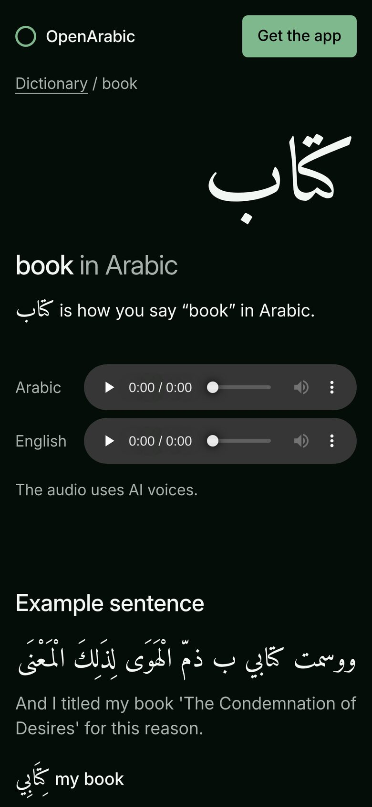

<p align="center">
  <a href="https://openarabic.io">
    
  </a>
</p>

<p align="center">
  The website for the OpenArabic app: 13,900 prerendered Astro pages on a Cloudflare Worker,<br>
  built from a saved snapshot of the app's texts and dictionary.
</p>

<p align="center">
  <a href="https://openarabic.io"><b>openarabic.io</b></a> ·
  <a href="https://apps.apple.com/app/openarabic/id1594031029">App Store</a> ·
  <a href="https://play.google.com/store/apps/details?id=com.edenmind.OpenArabic">Google Play</a> ·
  <a href="#development">Development</a> ·
  <a href="#docs">Docs</a>
</p>

<p align="center">
  <a href="https://github.com/YunusAndreasson/openarabic-web/actions/workflows/verify.yml"></a>
  <a href="LICENSE"></a>
</p>

<br>



OpenArabic is a free app for people who finished an Arabic course and still
can't read a book: excerpts from 22 classical works by six scholars, with
English above every Arabic line. One tap on a word gives you its meaning, a
grammar note and audio. If you can sound out Arabic script, you can start
reading classical texts. The app lives in
[YunusAndreasson/openarabic](https://github.com/YunusAndreasson/openarabic);
this repository is the site that promotes it and puts the same texts and
dictionary on the web. It has no accounts, sign-up or admin.

## Features

- **Reader.** All 239 texts, with English under every Arabic line. Tap a word
  for its meaning, a grammar note and audio. Each word is a plain link to its
  dictionary page, so a text still reads with JavaScript off, and the script
  that adds the card is about 1 KB gzipped.
- **Dictionary.** 13,600+ word pages with meanings, audio and example
  sentences from the texts, at the same addresses as on the old site, so
  search results still land. Search runs in the Worker against an index
  bundled at build.
- **Try it.** Near the end of the home page is a line from Ibn al-Jawzī: tap
  the words you don't know, then hide the English and read it. The app has no
  Arabic-only reader, so that moment belongs to the page.
- **Word colour.** Colour shows how multi-part words are built: the article,
  a joined preposition or conjunction, a possessive ending. The parts come from
  the app's own classifier, so the web and the app agree.
- **Analytics choice.** Google Analytics loads only for visitors who switch it
  on. Page views and store taps are counted by the Worker with no cookie, so
  they count every visitor.
- **`pnpm ship`.** The one way to deploy. The old site's Worker shares the
  Cloudflare account, so it refuses any Worker name but this site's. It reads
  the content with the public key, holds unexpected changes for approval,
  checks budgets, claims and every old URL, then checks the live domain and
  rolls back if that fails.

<table>
  <tr>
    <td width="25%"></td>
    <td width="25%"></td>
    <td width="25%"></td>
    <td width="25%"></td>
  </tr>
  <tr>
    <td align="center"><sub><b>Read</b>, the app on the page</sub></td>
    <td align="center"><sub><b>Try it</b>, a word tapped</sub></td>
    <td align="center"><sub><b>Reader</b>, the card as a sheet</sub></td>
    <td align="center"><sub><b>Dictionary</b>, one word's page</sub></td>
  </tr>
</table>

## Development

You need Node 26 and the pnpm version pinned in `package.json`.

```sh
pnpm install --frozen-lockfile
pnpm dev          # http://localhost:4321
pnpm ship:test    # the deploy's guards, end to end, on fixture data
```

A fresh clone has no content snapshot, so `pnpm dev` serves the home page
only; the other pages need the snapshot `pnpm ship` saves. `pnpm ship:test`
builds and checks a whole site from fixture data with every network host
faked. It takes a few minutes and needs Chromium at `/usr/bin/chromium` for
the lab budgets. CI runs it on every push.

Deploys go live on openarabic.io, so only the owner runs them, with
`pnpm ship --production`. [AGENTS.md](AGENTS.md) has the full command list and
the rules that keep a deploy from touching anything but this site's Worker.

## Docs

- [DESIGN.md](DESIGN.md): colours, type, components and the review checks.
  `pnpm tokens` generates the CSS tokens from it.
- [PRODUCT.md](PRODUCT.md): what the site may say about the app, and the
  phrases `pnpm ship` refuses to publish
- [docs/decisions/](docs/decisions/): dated decision records, the owner's calls
  among them
- [docs/provenance.md](docs/provenance.md): where each photograph came from

## Under the hood

- [Astro](https://astro.build) with the
  [Cloudflare adapter](https://docs.astro.build/en/guides/integrations-guide/cloudflare/),
  every page prerendered
- [Cloudflare Workers](https://developers.cloudflare.com/workers/) with static
  assets, and [Workers Analytics Engine](https://developers.cloudflare.com/analytics/analytics-engine/)
  for the counts
- [Supabase](https://supabase.com), the app's database, read once per deploy
- [Amiri](https://github.com/aliftype/amiri) for Arabic and
  [Inter](https://github.com/rsms/inter) for English, both subset
- [Playwright](https://playwright.dev) for the lab budgets and the reader's
  checks
- [design.md](https://github.com/google-labs-code/design.md) to lint
  DESIGN.md and generate its tokens

## License

The code is [MIT](LICENSE). The photographs, the app screens, the texts,
translations and audio, and the OpenArabic name, logo and social card are not;
[NOTICE.md](NOTICE.md) lists them. Amiri and Inter are used under the SIL Open
Font License.
